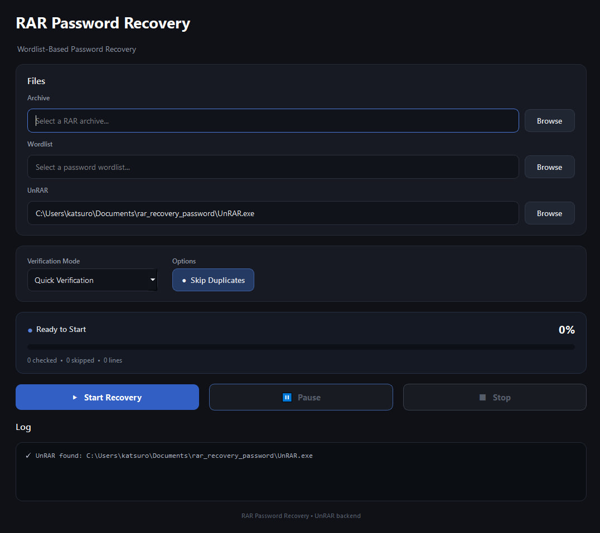

# 🔐 RAR Password Recovery

[](https://github.com/Dimash357/Rar_password_recovery/actions/workflows/tests.yml)


<p align="center">
  <strong>A lightweight Python tool for recovering passwords from password-protected RAR archives using a wordlist.</strong>
</p>

<p align="center">
  
  
  
  
</p>

<p align="center">
  <a href="#-features">Features</a> •
  <a href="#-screenshots">Screenshots</a> •
  <a href="#-installation">Installation</a> •
  <a href="#-usage">Usage</a> •
  <a href="#-roadmap">Roadmap</a>
</p>

---

## 📖 About

**RAR Password Recovery** is a desktop application designed to help users recover passwords for RAR archives they own or are authorized to access.

Built with Python and PyQt6, it provides a graphical interface for wordlist-based password recovery, progress monitoring, and controlling the recovery process.

Instead of working entirely in the terminal, users can select an archive, load a wordlist, and monitor the process through a simple, modern interface.

## ✨ Features

- 🔑 **Wordlist-based recovery** — test candidate passwords from a wordlist.
- 🖥️ **Modern GUI** — a clean desktop interface built with PyQt6.
- ⏯️ **Pause and resume** — temporarily pause the recovery process and continue when needed.
- ⏹️ **Stop control** — stop a running recovery session.
- 📊 **Live progress** — monitor progress and recovery statistics.
- 📝 **Activity logs** — follow the recovery process through real-time messages.
- ⚙️ **UnRAR detection** — locate the UnRAR utility automatically when available.
- 📦 **Modular architecture** — separate application logic from the user interface.
- 🪶 **Lightweight** — built with Python and a small set of dependencies.

## 📥 Download

You can download the latest Windows version of **RARVault** from the [Releases](https://github.com/Dimash357/Rar_password_recovery/releases) page.

### Windows

1. Open the [latest release](https://github.com/Dimash357/Rar_password_recovery/releases/latest).
2. Download `RARVault.exe` from the **Assets** section.
3. Run the downloaded executable.

**Note:** Windows may display a security warning because the application is not digitally signed. Only run software you trust.

### Run from source

If you prefer to run the application from source, see the installation instructions below.

## 🖼️ Screenshots

<!-- Replace this placeholder with a screenshot of the application. -->
<p align="center">
  
</p>

## 🛠️ Built With

| Technology | Purpose |
|---|---|
| [Python](https://www.python.org/) | Core application logic |
| [PyQt6](https://pypi.org/project/PyQt6/) | Desktop graphical interface |
| [rarfile](https://pypi.org/project/rarfile/) | RAR archive handling |
| [UnRAR](https://www.rarlab.com/) | Archive testing and password verification |

## 📋 Requirements

- Python 3.10 or newer
- Windows (the current implementation is designed primarily for Windows)
- A compatible UnRAR executable
- A wordlist containing candidate passwords

## 🚀 Installation

### 1. Clone the repository

```bash
git clone https://github.com/Dimash357/Rar_password_recovery.git
cd Rar_password_recovery
```

### 2. Create a virtual environment

```bash
python -m venv .venv
```

Activate it on Windows:

```powershell
.venv\Scripts\Activate.ps1
```

If you use Command Prompt instead:

```bat
.venv\Scripts\activate.bat
```

### 3. Install dependencies

```bash
pip install -r requirements.txt
```

### 4. Configure UnRAR

Make sure a compatible `UnRAR.exe` is installed and accessible to the application. If automatic detection does not find it, select the executable manually in the application, if that option is available in your version.

### 5. Launch the application

```bash
python main.py
```

## 📚 Usage

1. **Select an archive** — choose the password-protected RAR file.
2. **Load a wordlist** — select a text file containing candidate passwords, one per line.
3. **Configure options** — adjust the available recovery settings.
4. **Start recovery** — begin testing password candidates.
5. **Monitor progress** — review progress, statistics, and activity logs.
6. **Pause, resume, or stop** — control the process whenever necessary.
7. **Review the result** — if a matching password is found, the application reports it.

### Example wordlist

Create a file named `wordlist.txt`:

```text
password
123456
qwerty
admin123
letmein
```

The quality of the wordlist significantly affects the chances of recovering a password. Wordlist-based recovery only tests the candidates provided; it does not guarantee that a password will be found.

## 📁 Project Structure

```text
Rar_password_recovery/
├── core/
│   ├── __init__.py
│   ├── password_checker.py
│   └── unrar_utils.py
├── ui/
│   ├── __init__.py
│   ├── main_window.py
│   └── styles.py
├── main.py
├── requirements.txt
├── README.md
└── LICENSE
```

The project separates the core password-checking logic, archive utility detection, and graphical interface to make the code easier to maintain and extend.

## 🗺️ Roadmap

- [x] Graphical user interface
- [x] Wordlist-based password recovery
- [x] Real-time progress and logging
- [x] Pause, resume, and stop controls
- [x] Packaged Windows executable
- [x] Improved error handling and automated tests
- [ ] Recovery speed and elapsed-time statistics
- [ ] Estimated time remaining
- [ ] Save and export recovery results
- [ ] Additional recovery configuration options

## 🤝 Contributing

Contributions, bug reports, feature requests, and suggestions are welcome!

1. Fork the repository.
2. Create a feature branch:

   ```bash
   git checkout -b feature/your-feature
   ```

3. Commit your changes:

   ```bash
   git commit -m "Add your feature"
   ```

4. Push your branch and open a Pull Request.

For major changes, consider opening an issue first to discuss your proposal.

## ⭐ Support the Project

If you find this project useful, please consider giving it a **star ⭐** on GitHub.

It helps more people discover the project and motivates further development.

## 🔒 Responsible Use

This tool is intended for recovering passwords from archives you own or have explicit permission to access.

Use it responsibly and comply with applicable laws and the terms governing any data you process.

## 📄 License

This project is intended to be released under the MIT License. See the `LICENSE` file for details.

---

<p align="center">
  Built with ❤️ using Python and PyQt6.
</p>
